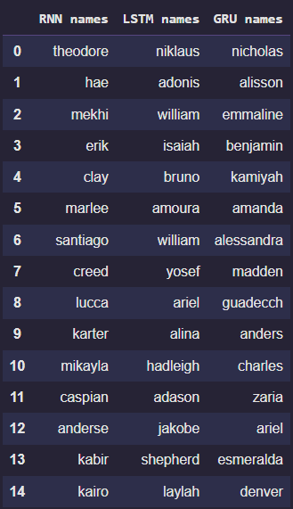

## Character-Level Name Generator (RNN vs LSTM vs GRU)

This project implements and compares three different Recurrent Neural Network architectures (RNN, LSTM, and GRU) using PyTorch. 
The goal was to train these models on a dataset of names to generate new, unique names character-by-character.
The project is inspired by Andrej Karparthy's Makemoore model, so do check it out!

## Features

- Distinct implementations of Vanilla RNN, LSTM, and GRU.
- Character-Level Generation: The models learn the probability of the next character in a sequence to generate new names.

## Project Structure
- main.py: Controls the flow between training, loading models, and generating names, toggle the "train" variable 1 if you want to train the models again with different parameters or more data of your own.
- models.py: Defines the model architecture for all 3 models using pytorch.
- trainers.py: Contains the training loops and optimization logic for each model.
- make_data.py: Handles data preprocessing, cleaning, character encoding, and DataLoader creation.
- utils.py: Utility functions for generating names.
- names.txt: A text file containing a list of names of several people 
- generated_names.csv: A csv file with an example of how the generated names look like.
- state_dicts of all 3 trained models that can be loaded into the project and played with.

## Results
The output is a Pandas DataFrame comparing the output of the three architectures

Thank you! Feel free to give your valueable suggestions or if any issues found.

